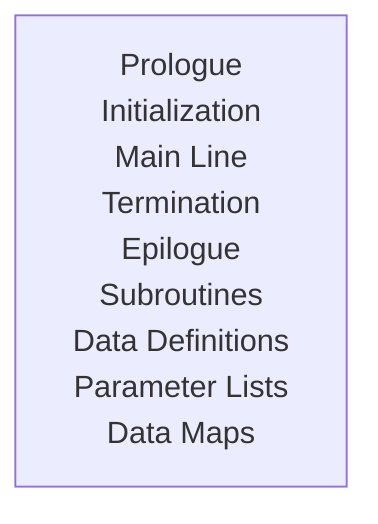

### Assembler Programming 
#### Program Organization
This module will help to understand Assembler program. Especially makes it easier to code and understand. In the current section it will be about code sequences for **non-ESA** and ESA (**_Electronic Sub Assembly_**) environments. It will also include OS/390 environment.

The non-ESA environments include System/370 and 370/XA environments. The code sequences that apply to these can be used in an ESA environment without any change. 

#### Program Organization -> Programming Conventions 
There are no fixed rules or requirements for the Assembler programs, still there is a chance within the syntax that can improve program maintainability and readability.

