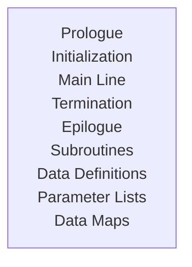

### Assembler Programming 
**Assembler** is a program for converting instructions written in low-level assembly code into relocatable machine code and generating along information for the loader. It is necessary to convert user-written programs into machinery code. This is called a translation of a **high-level language** to a **low-level that is machinery language**.

- Fundamental of most of the programming. 
- Language of the hardware. Such as 8086/8088 assembly language comes **_from The Intel 8086 and Intel 8088 are 16-bit CISC microprocessors_**
- Assembly code is more human understandable format of a **_machine code_**. 

#### Types of Assembler 
The assembler generates instructions by evaluating the **mnemonics (symbols)** in the operation field and finding the value of symbols and literals to produce machine code. On the basis of this functionality, assembler has two types:

- **_Single-Pass Assembler:_** If an assembler does all this work in one scan then it is called a single-pass assembler.
- **_Multiple-Pass Assembler:_** If it does it in multiple scans then called a multiple-pass assembler.

#### Program Organization
This module will help to understand Assembler program. Especially makes it easier to code and understand. In the current section it will be about code sequences for **non-ESA** and ESA (**_Electronic Sub Assembly_**) environments. It will also include OS/390 environment.

The non-ESA environments include System/370 and 370/XA environments. The code sequences that apply to these can be used in an ESA environment without any change. 

#### Program Organization -> Programming Conventions 
There are no fixed rules or requirements for the Assembler programs, still there is a chance within the syntax that can improve program maintainability and readability.

#### Program Organization -> Prologue
Depending on the environment, this section will save the status of the program that called this routine. It will also set up the base register(s) and local save areas, if any exist. **All programs should have a prologue**. 

#### Program Organization -> Initilization 
Any program can be a initialisation, such as opening a file to be processed or obtaining working storage, is contained in this section of the code. These tasks can be classified as **_general program housekeeping functions**_. 

#### Program Organization -> Main Line 
This section contains of the **main program code**. It comprise several calls to internal subroutines contained in the program. This intention is to keep the main line code very small, so that an overview of the entire program flow can be obtained by looking at one or two pages of main line code. 

